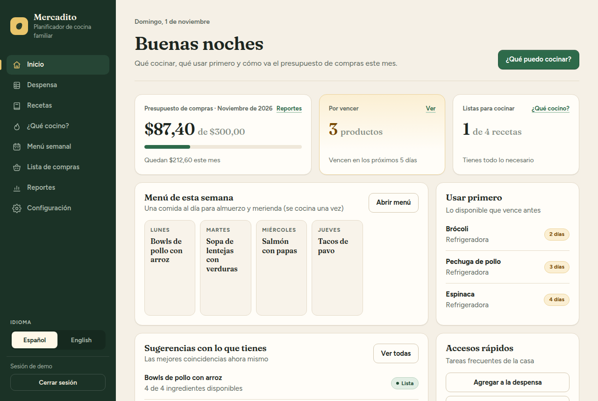
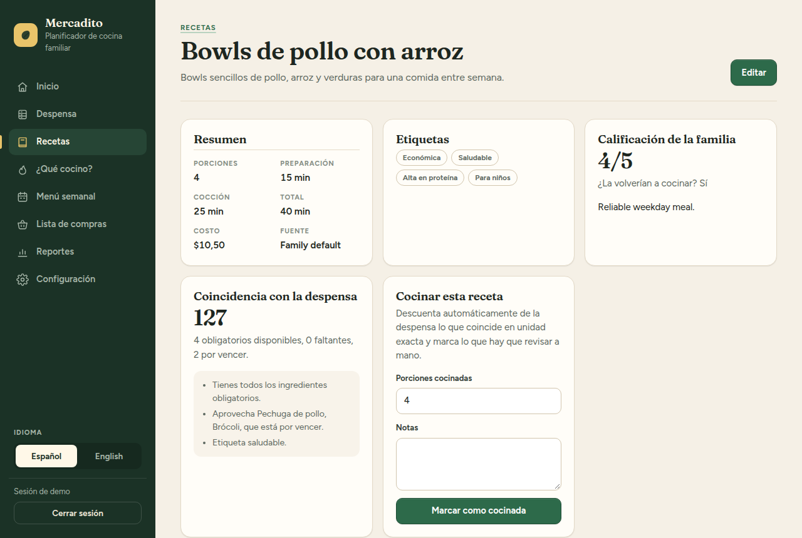
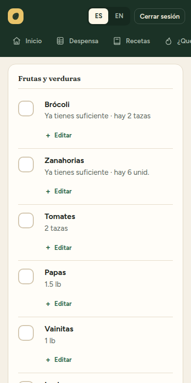

# Mercadito

**Un planificador de cocina para familias que se instala en tu propia computadora o servidor.** Lleva la cuenta de lo que hay en la despensa, encuentra qué cocinar con eso, planifica la semana, arma la lista de compras y revisa cómo va el presupuesto. Tus datos se quedan contigo.

[Read in English](README.md) · [Licencia: AGPL-3.0](LICENSE)



## Qué hace

- **Despensa**: lo que tienes, dónde está y qué vence pronto. Cada producto puede tener una cantidad exacta (2 lb) o aproximada ("media funda").
- **Recetas en dos idiomas**: cada receta, paso e ingrediente se puede escribir en español, en inglés o en ambos. Si falta un texto, se muestra el del otro idioma.
- **¿Qué cocino?**: ordena las recetas según lo que hay en la despensa, lo que está por vencer, las etiquetas de salud y presupuesto, y qué tanto le gustaron a la familia.
- **Menú semanal**: genera los días y comidas que elijas (una comida compartida para almuerzo y merienda, comidas separadas, solo almuerzo o solo merienda), con una comida vegetariana opcional por semana. Apruebas, omites o cambias comidas antes de comprar.
- **Lista de compras**: sale del menú aprobado, resta lo que ya tienes y agrupa por categoría. En el súper marcas lo que compras y lo pasas a la despensa en un paso.
- **Cocinar**: al marcar una receta como cocinada, sus ingredientes se descuentan de la despensa, empezando por lo que vence antes.
- **Gastos y reportes**: presupuesto de compras por semana o por mes, comidas fuera, gasto por categoría, recetas más cocinadas y promedios de nutrición.
- **Configuración del hogar**: integrantes con edad y dieta, país, moneda, unidades, idioma, presupuesto y cómo come tu familia.
- **Interfaz en español e inglés**, con selector en todas las páginas.
- **Privado por defecto**: un hogar por instalación, con una cuenta protegida por contraseña.

| Receta | Lista de compras en el celular |
|---|---|
|  |  |

> **Estado del proyecto:** temprano. Empezó como herramienta para una familia y ahora es abierto para que otras personas lo usen y lo mejoren. Habrá cambios; haz copias de seguridad (abajo explico cómo).

## Instalación

Necesitas **Docker** y **Git**. Todo corre en contenedores, así que funciona igual en Windows, macOS y Linux.

- Windows y macOS: [Docker Desktop](https://www.docker.com/products/docker-desktop/)
- Linux: [Docker Engine](https://docs.docker.com/engine/install/) con el plugin de Compose

```sh
git clone https://github.com/dzuritaa/mercadito.git
cd mercadito
cp .env.example .env
```

En PowerShell de Windows, `cp` también funciona (es un alias de `Copy-Item`).

Abre `.env` con cualquier editor de texto y define al menos:

- `POSTGRES_PASSWORD`: una contraseña larga y aleatoria para la base de datos.
- `TZ`: tu zona horaria, por ejemplo `America/Guayaquil` o `America/Mexico_City`.

Luego arráncala:

```sh
docker compose up -d --build
```

La primera vez tarda unos minutos. Abre **http://localhost:3000**:

1. Crea la cuenta del hogar (usuario y contraseña).
2. Responde las preguntas de configuración: integrantes, país, presupuesto y cómo planificas las comidas.

### Pruébala con recetas de ejemplo

```sh
docker compose exec app npm run db:seed-demo
```

Agrega cuatro recetas bilingües y, si la semana actual todavía no tiene menú, un menú de ejemplo. Si lo vuelves a correr, actualiza las recetas de ejemplo y nunca reemplaza un menú que ya exista.

## Tareas frecuentes

### Usarla desde el celular en casa

Por defecto, la app solo responde en la computadora donde corre. Para abrirla desde otros dispositivos de tu red:

1. En `.env`, pon `BIND_ADDRESS=0.0.0.0`.
2. Ejecuta `docker compose up -d`.
3. En el celular, abre `http://<IP-de-tu-computadora>:3000`.

Con HTTP simple, la contraseña viaja sin cifrar dentro de tu red. En casa suele ser aceptable; **para usarla fuera de casa, ponla detrás de HTTPS**. En [docs/https.md](docs/https.md) hay una configuración lista.

### Actualizar

```sh
git pull
docker compose up -d --build
```

Las migraciones de la base de datos se aplican solas al arrancar.

### Copia de seguridad y restauración

Crea una copia (`backup.dump`) en la carpeta del proyecto:

```sh
docker compose exec postgres pg_dump -U mercadito -d mercadito -Fc -f /tmp/backup.dump
docker compose cp postgres:/tmp/backup.dump ./backup.dump
```

Si cambiaste `POSTGRES_USER` o `POSTGRES_DB` en `.env`, usa esos valores en lugar de `mercadito`.

Restáurala (reemplaza los datos actuales):

```sh
docker compose cp ./backup.dump postgres:/tmp/backup.dump
docker compose exec postgres pg_restore -U mercadito -d mercadito --clean --if-exists /tmp/backup.dump
```

### Olvidé la contraseña

No hay recuperación por correo. Quien administra el servidor puede definir una nueva:

```sh
docker compose exec app npm run user:reset-password
```

Imprime una contraseña temporal, desbloquea la cuenta y cierra la sesión en todos los dispositivos. También puedes elegir la contraseña: `... user:reset-password -- <usuario> --password "<contraseña nueva>"`.

### Detener o borrar

```sh
docker compose down        # detiene (los datos se conservan)
docker compose down -v     # detiene y BORRA todos los datos
```

## Configuración

Las opciones de instalación están en `.env`:

| Variable | Valor por defecto | Para qué sirve |
|---|---|---|
| `POSTGRES_PASSWORD` | — (obligatoria) | Contraseña de la base de datos. Defínela antes del primer arranque. |
| `TZ` | `UTC` | Zona horaria para "hoy", los avisos de vencimiento y el menú semanal. |
| `BIND_ADDRESS` | `127.0.0.1` | `127.0.0.1` = solo esta computadora; `0.0.0.0` = tu red. |
| `APP_PORT` | `3000` | Puerto en tu computadora. |

Todo lo demás (hogar, presupuesto, moneda, unidades, idioma, menú) se configura dentro de la app, en **Configuración**.

## Conviene saber

- Las cantidades se comparan solo cuando la unidad es exactamente la misma. Si una receta pide "2 tazas de arroz" y en la despensa hay "1 kg de arroz", la app sabe que hay arroz pero no si alcanza, así que te pide revisar.
- Las alergias y dietas se guardan por integrante, pero por ahora el menú solo usa vegetariano y vegano. Para filtrar por gluten, lactosa, etc., las recetas necesitan datos de alérgenos (ver la [hoja de ruta](docs/ROADMAP.md)).
- Por ahora hay una cuenta por hogar.

## Contribuir

Reportes de errores, ideas, traducciones y código son bienvenidos, en español o en inglés. En [CONTRIBUTING.md](CONTRIBUTING.md) está cómo preparar el entorno de desarrollo. Para reportar un problema de seguridad en privado, mira [SECURITY.md](SECURITY.md).

## Licencia

[GNU Affero General Public License v3.0](LICENSE). Puedes usar, estudiar, modificar y compartir este software. Si distribuyes una versión modificada, o permites que otras personas usen una versión modificada a través de una red, debes compartir su código fuente bajo la misma licencia.
