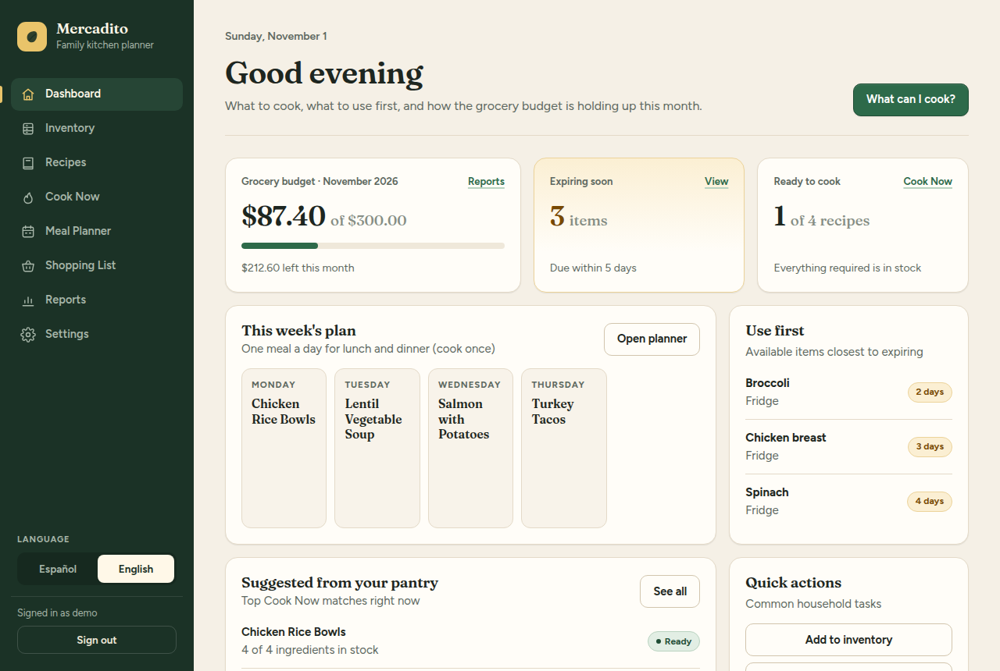
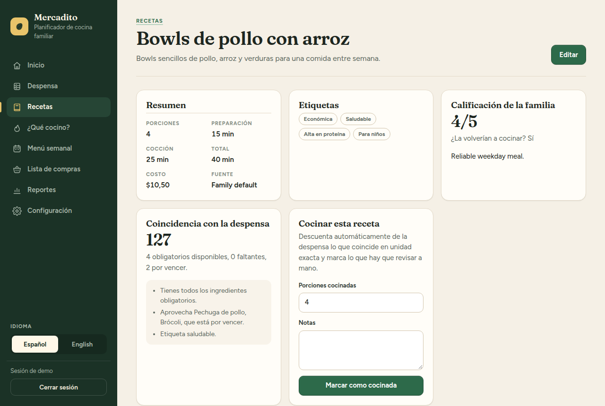
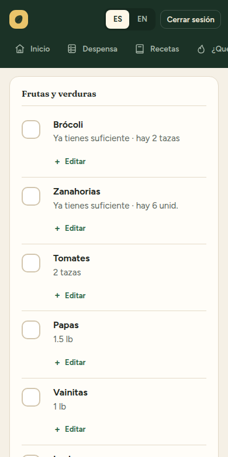

# Mercadito

**A self-hosted kitchen planner for families.** *Mercadito* means "little market" in Spanish. Keep track of what's in the pantry, find recipes you can cook with it, plan the week, build the shopping list, and see how the grocery budget is doing. Your data stays on your own computer or server.

[Leer en español](README.es.md) · [License: AGPL-3.0](LICENSE)



## What it does

- **Pantry** — what you have, where it is, and what expires soon. Items can have an exact amount (2 lb) or an approximate one ("half a bag").
- **Recipes in two languages** — every recipe, step, and ingredient can be written in Spanish, English, or both. Missing text falls back to the other language.
- **What can I cook?** — ranks recipes by what's in the pantry, what's about to expire, health and budget tags, and how much the family liked them.
- **Weekly menu** — generates the days and meals you choose (one shared meal for lunch and dinner, separate meals, lunch only, or dinner only), with an optional vegetarian meal each week. Approve, skip, or swap meals before shopping.
- **Shopping list** — built from the approved menu, minus what you already have, grouped by category. Check items off at the store and move them into the pantry in one step.
- **Cooking** — marking a recipe as cooked subtracts its ingredients from the pantry, using what expires first.
- **Spending and reports** — grocery budget per week or month, eating out, spending by category, most-cooked recipes, and nutrition averages.
- **Household setup** — members with ages and diets, country, currency, units, language, budget, and how your family eats.
- **Spanish and English interface**, with a switch on every page.
- **Private by default** — one household per installation, with a password-protected account.

| Recipe | Shopping list on a phone |
|---|---|
|  |  |

> **Project status:** early. It started as a tool for one family and is now open so others can use and improve it. Expect changes, and keep backups (see below).

## Install

You need **Docker** and **Git**. Everything runs in containers, so it works the same on Windows, macOS, and Linux.

- Windows and macOS: [Docker Desktop](https://www.docker.com/products/docker-desktop/)
- Linux: [Docker Engine](https://docs.docker.com/engine/install/) with the Compose plugin

```sh
git clone https://github.com/dzuritaa/mercadito.git
cd mercadito
cp .env.example .env
```

On Windows PowerShell, `cp` works too (it is an alias of `Copy-Item`).

Open `.env` in any text editor and set at least:

- `POSTGRES_PASSWORD` — a long random password for the database.
- `TZ` — your time zone, for example `America/Mexico_City` or `Europe/Madrid`.

Then start it:

```sh
docker compose up -d --build
```

The first build takes a few minutes. Open **http://localhost:3000**:

1. Create the household's account (username and password).
2. Answer the setup questions: members, country, budget, and how you plan meals.

### Try it with sample recipes

```sh
docker compose exec app npm run db:seed-demo
```

This adds four bilingual recipes and, if the current week has no menu yet, a sample menu. Running it again refreshes the sample recipes and never replaces an existing menu.

## Everyday tasks

### Use it from your phone at home

By default the app only answers on the computer where it runs. To open it from other devices on your home network:

1. In `.env`, set `BIND_ADDRESS=0.0.0.0`.
2. Run `docker compose up -d`.
3. On the phone, open `http://<your-computer's-IP>:3000`.

On plain HTTP, the password travels unencrypted inside your network. That is usually acceptable at home; **to use it outside your home, put it behind HTTPS** — see [docs/https.md](docs/https.md) for a ready-made setup.

### Update

```sh
git pull
docker compose up -d --build
```

Database migrations run automatically when the app starts.

### Back up and restore

Make a backup file (`backup.dump`) in the project folder:

```sh
docker compose exec postgres pg_dump -U mercadito -d mercadito -Fc -f /tmp/backup.dump
docker compose cp postgres:/tmp/backup.dump ./backup.dump
```

If you changed `POSTGRES_USER` or `POSTGRES_DB` in `.env`, use those values instead of `mercadito`.

Restore it (this replaces the current data):

```sh
docker compose cp ./backup.dump postgres:/tmp/backup.dump
docker compose exec postgres pg_restore -U mercadito -d mercadito --clean --if-exists /tmp/backup.dump
```

### Forgot the password

There is no email reset. Whoever runs the server can set a new one:

```sh
docker compose exec app npm run user:reset-password
```

It prints a temporary password, unlocks the account, and signs out every device. You can also choose the password: `... user:reset-password -- <username> --password "<new password>"`.

### Stop or remove

```sh
docker compose down        # stop (data is kept)
docker compose down -v     # stop and DELETE all data
```

## Configuration

All settings live in `.env`:

| Variable | Default | What it does |
|---|---|---|
| `POSTGRES_PASSWORD` | — (required) | Database password. Set it before the first start. |
| `TZ` | `UTC` | Time zone for "today", expiry warnings, and the weekly menu. |
| `BIND_ADDRESS` | `127.0.0.1` | `127.0.0.1` = this computer only; `0.0.0.0` = your network. |
| `APP_PORT` | `3000` | Port on your computer. |

Everything else (household, budget, currency, units, language, meal plan) is set inside the app under **Settings**.

## Good to know

- Quantities are compared only when the unit matches exactly. If a recipe needs "2 cups of rice" and the pantry has "1 kg of rice", the app knows you have rice but can't tell if it's enough, so it asks you to check.
- Allergies and diets are saved per member, but menus currently use only vegetarian and vegan. Filtering by gluten, lactose, and so on needs allergen data on recipes (see the [roadmap](docs/ROADMAP.md)).
- One account per household for now.

## Contributing

Bug reports, ideas, translations, and code are welcome, in Spanish or English. See [CONTRIBUTING.md](CONTRIBUTING.md) to set up a development environment. To report a security problem privately, see [SECURITY.md](SECURITY.md).

## License

[GNU Affero General Public License v3.0](LICENSE). You can use, study, change, and share this software. If you distribute a modified version, or let other people use a modified version over a network, you must share its source code under the same license.
